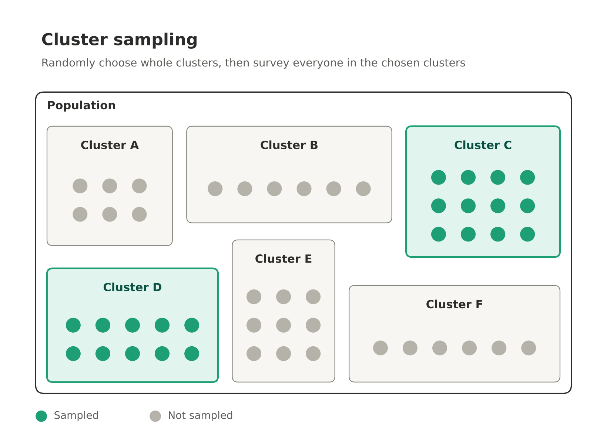
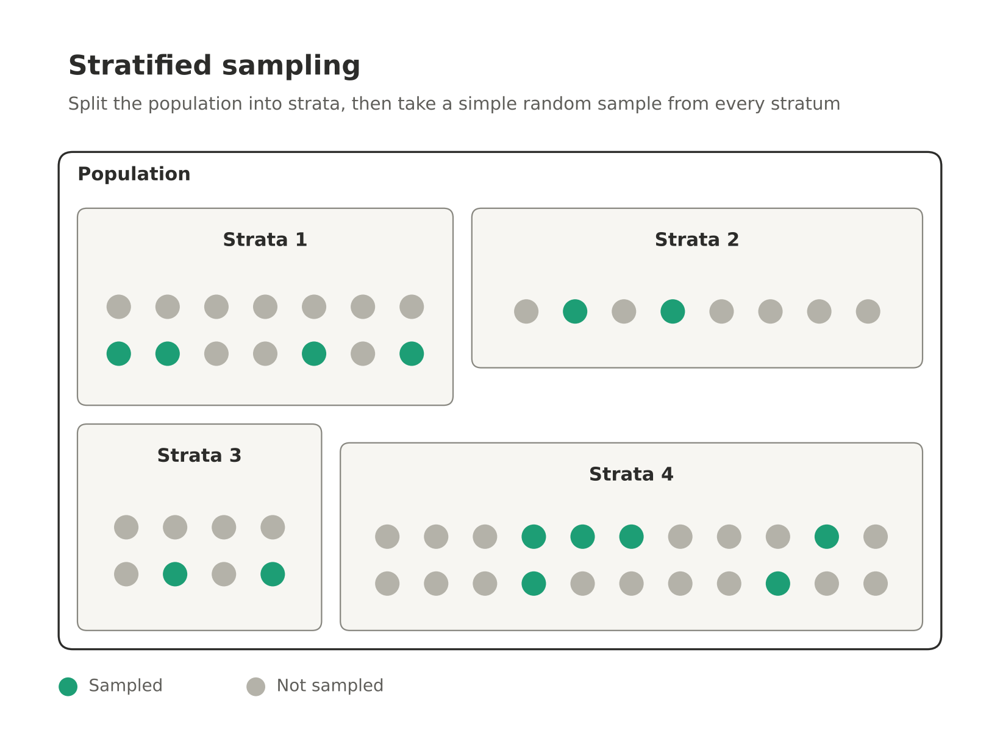
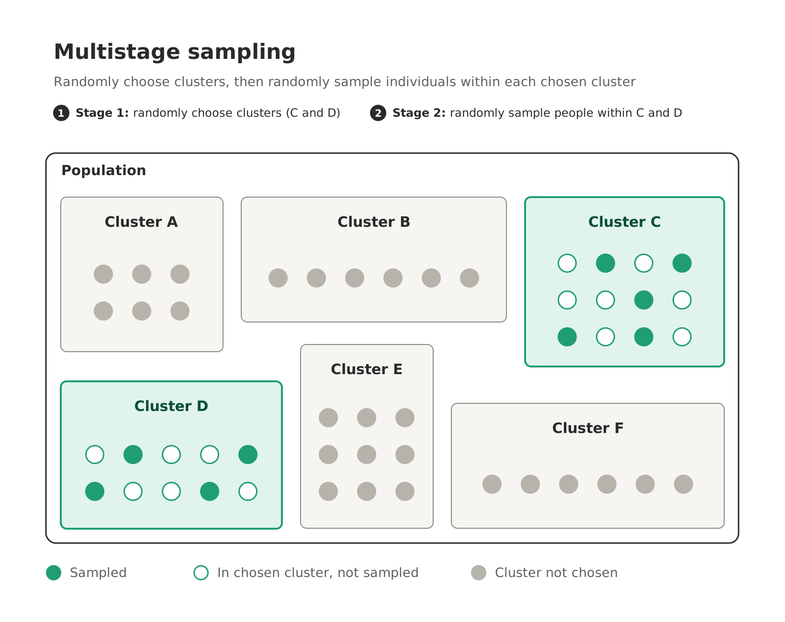

# Sampling and Study Design

## Sampling 

Sampling is the way we select participants for a study. Sampling design is *crucial* for creating an unbiased study. 

**Simple random sampling** involves selecting randomly from the entire population. In practice, there are many limiting factors involved in generating a truly simple random sample. 

::: {#exm-srs}
## Simple Random Sample

What is the *intended* population of each study? How do the following random samples fail to reflect the entire population or be genuinely random?

1. A city wants to know how adult residents feel about expanding bus service. Planners get the list of every account on the city’s water and electric billing system and randomly select 1,000 accounts to survey. 

2. A polling firm wants to estimate support for a ballot measure among adults in Ohio. It buys a list of all published residential phone numbers in the state and uses software to randomly select 1,500 numbers to call.

3. A grocery store chain wants to know how satisfied its customers are with checkout wait times. It pulls the list of all transactions from the past month in its system and randomly selects 500 of them. It then contacts each matched customer through the email linked to their loyalty account.
:::

::: {.callout-tip collapse="true"}
## Answer 

1. They are only sampling from names listed on a utility bill. Those who live with roommate ro cooperative housing are excluded from the survey. 

2. This survey is excluding households without a landline, which could lead to bias in the sample. 

3. There are two main issues with this. The survey is not truly random because customers who shop more are more likely to get contacted. Additionally, only those signed up for rewards are contacted. 
:::

We refer to the **sampling frame** as the actual population where the sample was taken from. Like in the above example, the sampling frame can be different from the intended population. 

**Systematic** sampling is when we choose from the population in a systematic fashion, e.g. picking every 5th name in an alphabetized list, picking every 3rd person to show up at a clinic. 

**Cluster sampling** is when we break the population down into clusters, randomly select some of the clusters, and use every individual in the selected clusters. 

{fig-align="center"}

::: {#exm-clustersampling}
When it is a bad idea to use cluster sampling? 
:::

::: {.callout-tip collapse="true"}
## Answer

Don't use cluster sampling if your clusters vary widely in make up (with relation to your survey). For example, suppose I was asking the question "Does your household have access to a car?" Clustering by cities in the Sound are would be a bad idea, as we expect those in Seattle & Tacoma to have lower rates of car access than a Bainbridge Island or Gig Harbor. 
:::

**Stratified sampling** is when we break down a population into strata and sample randomly *from each* strata. This is a good type of sampling to do if you can identify potential groupings in the population where you expect major differences. 

{fig-align="center"}

::: {#exm-stratasampling}
## Stratified Sampling
The county transit authority wants to estimate the percentage of Cuyahoga County (Cleveland, OH and surrounding area) households that don’t have access to a car, to help plan bus routes. They decided to use *stratified sampling* to pick a random sample of the county population. For each city/town in the county they sample roughly 15% of the population. 
:::

::: {.callout-important}
## Clusters Versus Strata

There's no difference in the meaning between the terms *cluster* and *strata*. In both cases we are breaking the population down into groups. 
:::

**Multistage sampling** is when a mix of methods is applied to different levels. 

{fig-align="center"}

::: {#exm-sampleidentify}
## Identify the Sampling 

For each scenario identify the type of sampling used as *simple*, *systematic*, *cluster*, or *stratified*.

1. A teacher of a 500 person lecture wants to know how much time students on average on each homework assignment. The class contains freshmen, sophomores, and juniors, so the teach randomly selects 50 students from each class to sample. 

2. A grocery store manager wants to estimate customer satisfaction. Starting with a randomly chosen customer among the first 20 to check out on Saturday, the manager surveys every 20th customer who passes through the checkout line for the rest of the day.

3. A school district wants to know how many hours per week high school students spend on extracurricular activities. The district has 40 homerooms, so it randomly selects 6 homerooms and surveys every student in those homerooms.
:::

::: {.callout-tip collapse="true"}
## Answer 

1. This is stratified sampling, since we choose a random sample from each class. 

2. This is systematic sampling. 

3. This is cluster sampling, since we survey all the student in each homeroom. 
:::

## Study Design

There are three types of study design we will focus on learning:

* An **observational study** is when participants are asked about their variables in their life *without* researcher interference. An observational study is **prospective** if variables are recorded as they happen. An observational study is **retrospective** if participants recall information about the past. 

* A **survey** is where where participants are asked to report on certain variables related to themselves, typically through a form, survey, or interview. 

* An **experiment** is when researchers interfere instead of measuring variables as they occur naturally. Researchers assign the explanatory variable to participants and see how it impacts the response variables. 

::: {.callout-important}
## Surveys
A survey *is* a type observational study, however it earns a distinction because surveys ask participants to express their feelings/opinions. An observational study (not survey), typically relies on observation, tracking, or medical records.
:::

::: {#exm-studytype}
## Study Types

Determine whether each study is an observational study, survey, or experiment.

1. A researcher records how many cars run a red light at a busy intersection each day.
2. Students are randomly assigned to study with or without music, then take the same quiz.
3. A school emails parents a questionnaire asking how satisfied they are with the lunch menu.
4. Doctors review hospital records to compare heart disease rates in smokers and non-smokers.
5. Tomato plants are randomly given one of three fertilizers, and their yields are measured.
6. A pollster calls 1,000 voters and asks which candidate they plan to support.
:::

::: {.callout-tip collapse="true"}
## Answers

1. observational study (prospective)
2. experiment
3. survey
4. observational study (retrospective)
5. experiment
6. survey
:::

## Causation and Experiments

A *good* experiment should use randomization to control for other factors potentially impacting the response variable.

Consider an experiment where we trying to measure the efficacy of a new weight loss drug. The explanatory variable in this case is the new drug and the response variable would be measures of weight loss. 

In the experiment split individuals into a**treatment group**, who receive the drug and a **control group** who receive do not receive the drug. These groups should be *randomly assigned* and we should do so in a way that makes the two groups similar with respect to other factors that could impact weight loss. 

::: {#exm-otherfactors}
What are other factors we might want to control for when randomly assigning our groups?
:::

Another good idea would be to make the experiment **blind** this means the participants should not know whether they are in the treatment or control group as it could impact their behavior. We could administer a **placebo** to the control group.

We could go even further and make the experiment **double-blind** meaning that even the researchers don't know what group the participant was assigned to.

::: {#exm-blind}
Give an example of an experiment that is impossible to make blind. Give an example of an experiment that could be blind, but not double-blind. 
:::

## Survey Questions

Survey questions should be carefully thought through in order to be effective. When drafting questions, one should:

* Think about whether a question is better *open* or *closed*,
* Avoid planting ideas or leading questions,
* Avoid complicated questions addressing more than one idea, 
* Avoid unbalanced response options. 

::: {#exm-biasedquestions}
## Biased Survey Questions

Determine whether each survey question is biased or unbiased. If it is biased, explain why.

1. Do you agree that the school day starts too early?
2. How many hours of sleep did you get last night?
3. Should the city waste more taxpayer money on a new stadium?
:::

::: {#exm-betterquestion}
## Choosing the Better Question

For each pair, decide which survey question is better and explain why.

1. 
   a. Do you not disagree that homework should not be eliminated?
   b. Do you think homework should be eliminated?

2. 
   a. To what extent do you concur that the implementation of later start times would positively influence your academic performance and overall well-being?
   b. Would a later school start time help you do better in school?

3. 
   a. How satisfied are you with the school library?  
      ☐ Somewhat satisfied ☐ Satisfied ☐ Extremely satisfied ☐ Dissatisfied
   b. How satisfied are you with the school library?  
      ☐ Very dissatisfied ☐ Dissatisfied ☐ Neutral ☐ Satisfied ☐ Very satisfied
:::